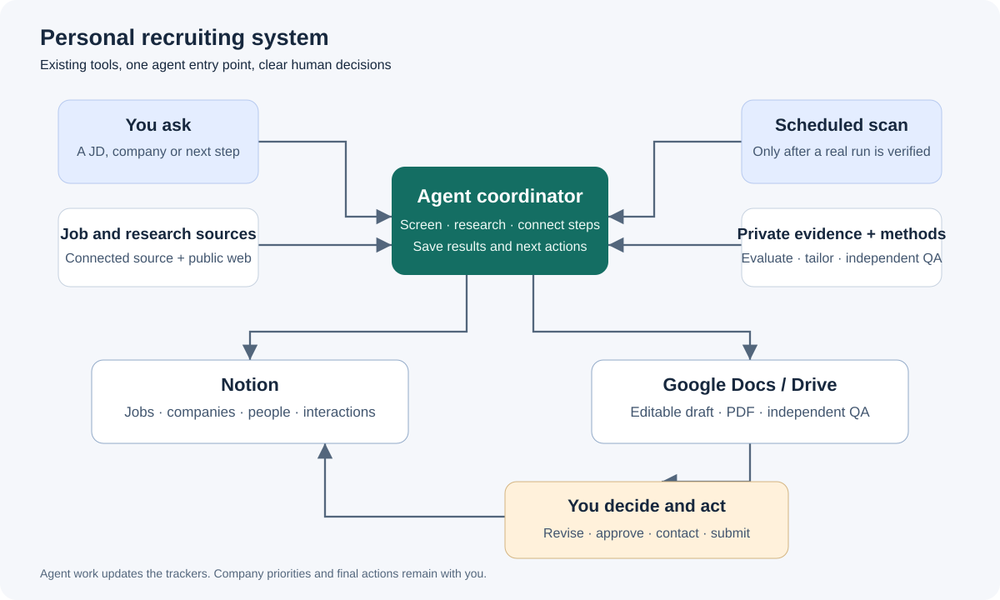
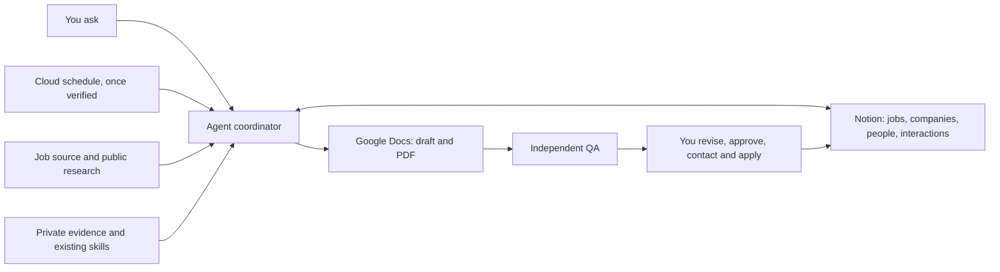

# Personal Recruiting System

A small, agent-assisted workflow for discovering opportunities, researching companies, managing professional relationships, and preparing evidence-based applications. It connects existing tools rather than introducing a custom website or backend.

This repository contains reusable instructions, prompts, a Notion schema, and diagrams. It contains no candidate profile, resume, personal recruiting strategy, live tracker export, contact list, credentials, or account configuration. Installing these files alone does not connect services or create a schedule.

## How the system works

The agent selects the appropriate existing method: evaluate a role, research a company, find or refresh contacts, tailor a resume, or independently review it. You can stop after any step. Your original evidence remains the authority for claims; an agent recommendation does not change your application status or company priorities.

## Design decisions

| Component | Job | Why it belongs here |
|---|---|---|
| Notion | Structured jobs, company pages, people, interaction history and next actions | Relations connect records without copying the same information into several trackers. |
| Google Docs / Drive | Editable application documents and exported PDFs | Document editing and final layout inspection are different work from tracking. |
| Agent coordinator | Route requests through existing evaluation, tailoring and QA methods | Reuses specialized methods while keeping one entry point. |
| Trackly or another connected job source | Discover roles and retrieve JDs | Source access is checked in the environment that will actually run the work. |
| A cloud-capable scheduler | Repeat a proven discovery/evaluation workflow | Required for operation while your computer is off; local scheduling is insufficient. |
| You | Priorities, corrections, final approval, networking messages and submission | These decisions remain explicit and reviewable. |

Company insights live as dated, sourced sections on company pages. Reuse an existing interaction table if available. There is no separate insights database, queue service, runs database, custom application, or deployment requirement.

## Duplicate the system

1. **Inspect your existing trackers.** Reuse jobs and contacts; back up affected schemas and rows privately before structural changes. Follow [the schema](docs/notion-schema.md), adding missing fields without changing existing status options or notes.
2. **Add Companies.** Make the existing Company column in Jobs and People a relation to Companies, with reciprocal Jobs/People links. Back up and map every existing company assignment before converting its type, then restore and verify those assignments. Keep one Company column per tracker. Avoid copied profile URLs when an existing field already holds them. Do not merge ambiguous identities automatically. Use [the company page template](templates/company-page.md).
3. **Create a private setup note.** Copy [the setup template](templates/private-setup.md) into your private workspace. Fill in destination links, your search scope, evidence locations, and method locations there. Never commit the completed note.
4. **Connect your tools.** Authorize Notion, your job source, and document tools in the actual chat/runtime you intend to use. Connector availability differs across environments. Test a bounded read and write; verify document copy, edit and export capabilities separately.
5. **Load your existing methods.** Keep your candidate-specific evaluation framework, tailoring method and independent QA method private. Install or load [the generic coordinator skill](skills/recruiting-coordinator/SKILL.md), then give it your private setup note. This repository deliberately does not supply personal scoring weights or targeting strategy.
6. **Run one interactive pilot.** Evaluate one existing job, save one sourced company insight, refresh one known contact without replacing notes, and create a resume draft from private evidence. Review proposed changes before finalization unless you explicitly request otherwise. Inspect the actual exported PDF.
7. **Create an actual one-time cloud task.** Follow [the scheduling procedure](docs/scheduling.md). Use [the smoke-test prompt](prompts/scheduled-smoke-test.md), record the real task link and run time, and observe the writeback while the computer is asleep. A prompt file is not a scheduled task.
8. **Create one recurring task after the test succeeds.** Use [the daily prompt](prompts/daily-scan.md), with your own time zone and cadence. Keep the first run small. Verify its history, Notion output and duplicate handling before expanding the scope.

For the detailed component boundaries, see [architecture](docs/architecture.md). To ask an assistant to implement your own copy, use [the build prompt](prompts/build-your-workspace.md). For on-demand commands and expected outputs, see [the coordinator](skills/recruiting-coordinator/SKILL.md). Before sharing your adapted copy, use [the privacy review](docs/privacy-review.md).

## Boundaries and verification

The workflow never infers qualifications, shared background, nationality, sponsorship eligibility or referral willingness from a name or employer. Unknowns remain visible. Search existing jobs by provider ID or canonical posting URL and people by verified professional profile before creating records. Preserve meaningful URL query parameters, such as requisition IDs.

Tailoring and QA are separate passes. QA uses the actual JD, candidate evidence and current document rather than trusting the tailoring explanation. A user edit invalidates checks on the affected text. Visual PDF review and text extraction must refer to the exact final file, not just a chat draft. An unavailable tool is reported as a blocked step, never as completed work.

## Tool documentation

- [Notion relations](https://www.notion.com/help/relations-and-rollups)
- [Trackly integration information](https://usetrackly.app/cli) — use the provider's supported connection flow.
- [ChatGPT scheduled tasks](https://learn.chatgpt.com/docs/automations) and [scheduling walkthrough](https://developers.openai.com/training/walkthroughs/scheduled-tasks) — check the current account's capabilities and execution environment.

This is a reproducible workflow kit, not a hosted service. No API subscription, additional paid runtime or unattended execution is assumed.
