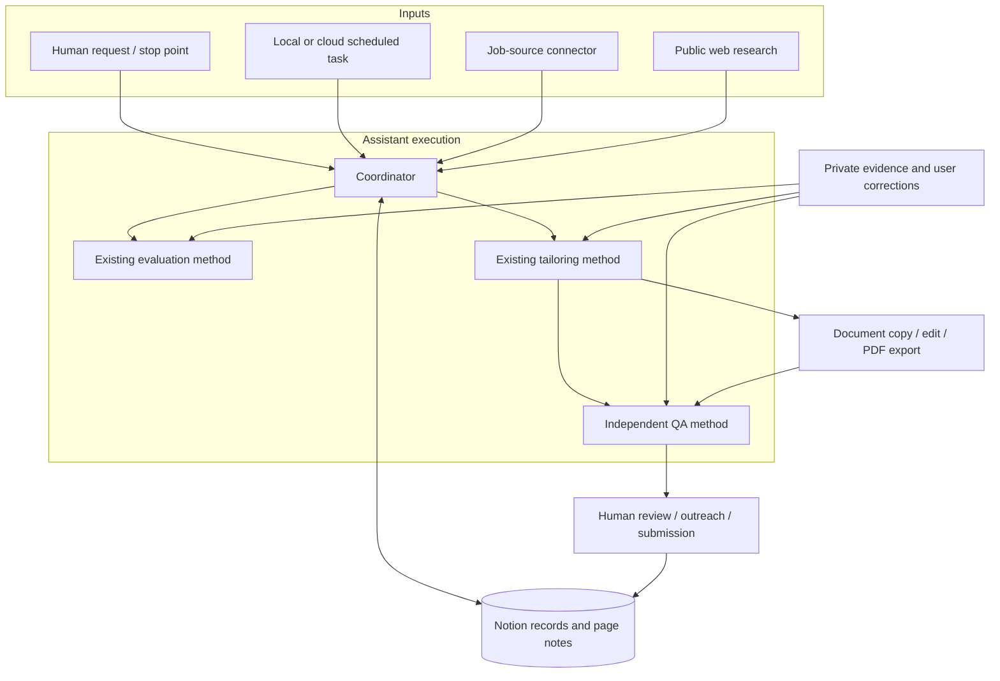

# Component architecture

This is a tool-connected workflow with persisted work in existing records. The coordinator is a reusable instruction set executed by the assistant, not a continuously running server.

| Boundary | Contract |
|---|---|
| Discovery → Jobs | Specific opening identity, canonical URL/provider ID, JD and source date; deduplicate before creation. |
| Evaluation → job page | Evidence-based decision, unknowns, sources, review state and next action; preserve application state. |
| Research → company page | Dated finding, source and recruiting implication; company may precede an opening. |
| Networking → People / Interactions | Verified identity and current facts on People; dated conversation and follow-up in Interactions. |
| Tailoring → document | Supported changes traceable to private evidence; original template preserved. |
| QA → human | Independent claim/coverage checks and actual-file inspection status; unresolved factual issues remain explicit. |

The job page is the resume point: last completed step, next step, requested stopping point and exact current artifact. The scheduler owns timing/history; a private setup note owns destination/method links and the latest report. Avoid simultaneous interactive and scheduled edits to the same record. No separate orchestration database is required for this single-user workflow.
