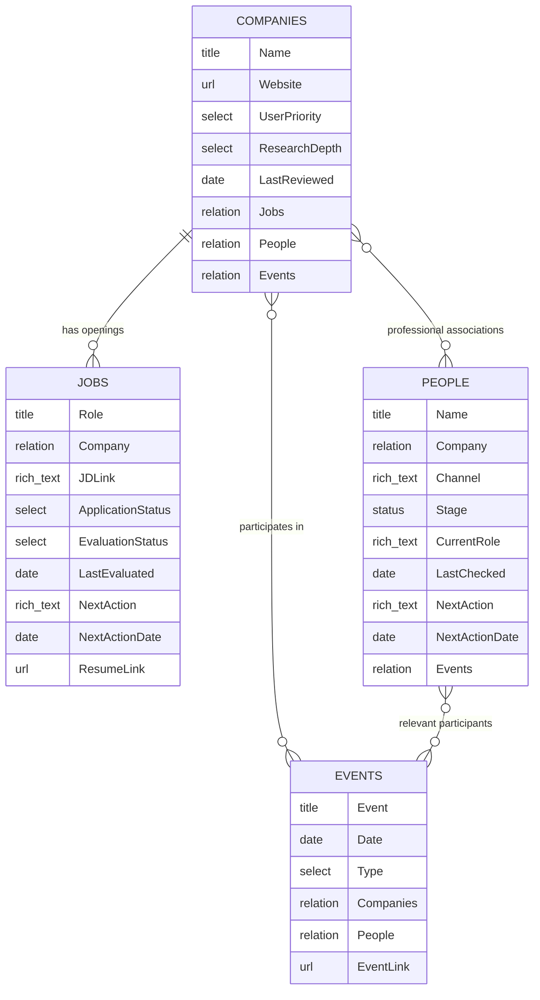

# Database schema

This is the single reference for fields, relations, page content and setup checks. Reuse existing names/status options and add a field only if an equivalent is absent. Four databases hold distinct records: Jobs, Companies, People and Events. An Events row represents an event with shared insights; individual conversations remain dated toggles inside a People page.

## Relations

**JD means a Jobs record**, not a separate database. **One company → many jobs.** A verified opening belongs to one company. An unresolved inbox item may temporarily have an empty Company field; resolve it before treating its identity as established. The diagram describes the intended model, not a claim that every live workspace enforces required fields. Native Notion page identities need no extra ID column.

| Entities | Cardinality | Reciprocal properties | Native limit settings |
|---|---|---|---|
| Company ↔ JD | One company to many JDs; each identified JD has exactly one company | Companies.Jobs ↔ Jobs.Company | Companies.Jobs: No limit; Jobs.Company: 1 page |
| Company ↔ Person | Many-to-many | Companies.People ↔ People.Company | No limit on both sides |
| Company ↔ Event | Many-to-many | Companies.Events ↔ Events.Companies | No limit on both sides |
| Person ↔ Event | Many-to-many | People.Events ↔ Events.People | No limit on both sides |

Enable the corresponding reverse property and reuse it if already present. Notion supports two-way relations and a `1 page` / `No limit` setting. Verify the actual setting; a textual schema is not proof it has been applied. [Official relation documentation](https://www.notion.com/help/relations-and-rollups).

## Verify the contract without overstating enforcement

Inspect targets and reciprocal properties for all four pairs above. Read complete saved views (including pagination), verify every stored reference has its matching reverse, and check each saved identified Job has exactly one Company. Preserve multiple Company associations on People and multiple Companies/People on Events. A link to an event must not overwrite a person's existing company associations.

The standard connector schema may omit native `1 page` / `No limit` settings and may not offer a supported setter. In that environment, report those UI flags as unverified; matching data is not proof of a configured limit. Inspect/set the properties in Notion's native editor using the table above. Do not claim a limit was changed through a tool that cannot expose it. The [official relation guide](https://www.notion.com/help/relations-and-rollups) explains these settings.

Agent writes must validate the final Jobs.Company array contains exactly one page; on an ambiguous multi-company JD, stop the affected write rather than truncating links. Preserve arrays on all other relation sides. After a write, read back both ends. These guards do not claim to prevent every manual/API edit in the workspace. Event relations may be empty while the event still has useful general insights. No direct JD–People or JD–Event relation is required by this model.

## Fields and page content

| Database | Minimum properties | Page body |
|---|---|---|
| Jobs | Existing role title, Company relation, JD link, application status and notes; evaluation state/date, next action/date, resume link if needed | Source/canonical identity; assessment with evidence and unknowns; last completed preparation step, requested stopping point, next step and exact draft version |
| Companies | Name, website, user priority, research depth, last reviewed; reciprocal Jobs, People and Events | Executive intelligence brief; six-section company profile; dated sourced insights; role/team criteria; open questions. See [company template](../templates/company-page.md). |
| People | Existing name, Company relation, profile/contact channel, relationship stage and notes; current role, last checked, next action/date if needed; reciprocal Events | Identity/source notes plus one dated toggle per actual conversation or outreach event. See [person template](../templates/person-page.md). |
| Events | Event title, Date, Type, Companies relation, People relation, Event Link | Overview, general insights, participant/company context, follow-ups and raw notes/sources. See [event template](../templates/event-page.md). |

Suggested evaluation states: Not evaluated, Screened out, Evaluated, Needs info, Error. This is separate from application status. Empty metadata does not prove an earlier assessment is absent: read the page first. Unknown eligibility is not a rejection. Retain existing application and relationship status options.

Research Depth can retain existing Basic (Quick alias) and Deep choices while adding Standard. Preserve saved values; use Standard at execution time only when neither a request nor saved depth exists. Company Intelligence sections belong in the existing page body, not six new columns or another database.

Jobs and People each retain their existing Company property. Events uses one plural Companies relation because many companies may participate; do not add a parallel text-company field.

Keep one Company property per tracker. Reuse JD Link and Channel/profile fields; do not add URL copies. Put a genuine provider/requisition ID in job-page metadata when useful. Deduplicate by employer and requisition/canonical URL, including aggregator mirrors. Two different openings at the same company are two Jobs rows, not duplicates.

## Conversation storage

Each contact's page contains dated native Notion toggles such as `YYYY-MM-DD — video call — product team`. Preserve every earlier toggle. Append new factual notes or revise the matching toggle when correcting that conversation; retrying the same request must not append it twice. Keep only the current next action/date in the People properties for sorting; the dated toggle retains its context and agreed follow-up. Draft outreach is labeled Draft and never recorded as sent without evidence.

## Event-level insights

Match events by name/date or canonical event URL before creating; retries update the same event. Save general takeaways even when no person/company is identified. Leave unknown dates and identity blank. Record whether attendance is established; saving an agenda or another person's notes does not prove attendance.

Company and People links provide context, not hiring evidence or relationship progress. Put a specific personal conversation in its People toggle and reference the event. Keep general event insights in Events. Reuse a company-specific finding in Company Intelligence only when requested, with event/date/speaker/context/uncertainty intact; a panel remark is not automatically official policy. No separate person-conversation table or join database is needed.

## Views and setup checks

Use **Needs evaluation** for active unreviewed/Needs info/Error jobs; **Considering decisions** for unresolved actions even after evaluation; **Companies** for priority/depth; and **Networking actions** for People with a due next action. Events has an All events table sorted newest first, optional company/people/type quick filters, and a Calendar by Date. No person-conversation-table view is needed.

1. Read the live schemas and privately back up affected records, views and company assignments. Complete pagination before claiming full coverage.
2. Reuse/create Companies; map old labels to specific company pages. Resolve ambiguous aliases; preserve blanks and all existing associations. Do not collapse several job rows into one company row.
3. Migrate the existing Jobs.Company to a relation, restore mapped values, enable reciprocal Jobs and set the single-page limit. If old rows have multiple companies, resolve those cases before restricting them; do not silently drop values.
4. Migrate People.Company similarly, retaining multiple associations and reciprocal People. Keep all conversation toggles and notes in their original person pages. Do not move personal conversation history into Events or delete a legacy table.
5. Create/reuse Events when event-level capture is needed, add multi-page Companies/People relations and reciprocal Events properties only where absent, then verify targets and preserve existing record values. Keep event insights in page content.
6. Read back all mapped assignments and unaffected statuses/notes/dates. Check two different jobs opening the same company page, the company's reverse Jobs list, a person's company links and unchanged conversation toggles. Inspect the real relation limits and views.

These steps describe the target setup, not an instruction to run unverified connector-specific DDL. Use the chosen connector's documented capabilities or the Notion UI after inspecting the live schema. See the [build prompt](../prompts/build-your-workspace.md).

## Inspect the fictional records

The [case checkpoint](../examples/fictional-case/README.md#continuation-checkpoint), [role assessments](../examples/fictional-case/outputs/job-evaluation.md), [company page](../examples/fictional-case/outputs/company-brief.md) and [People page](../examples/fictional-case/outputs/people-page.md) show this model with invented records. One company owns two distinct openings; both hypothetical conversations remain inside one People page. These Markdown fixtures do not create Notion databases.

The [fictional event](../examples/fictional-case/outputs/event-page.md) demonstrates general insights linked to existing company/person records without claiming outreach or moving individual conversations.
