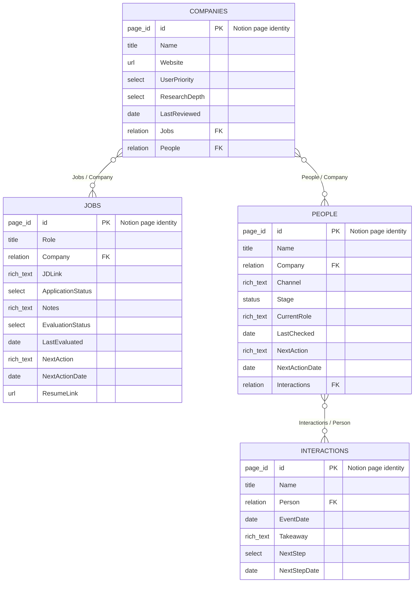

# Database schema and relations

Four Notion databases hold the working information. Company research belongs on company pages, job assessments on job pages, and conversation notes in interaction records. Existing tracker names and title-property names can differ; map them before applying this schema.



The diagram shows the list-valued relations supported by this configuration: they permit zero or more linked pages. In normal recruiting work, a job belongs to one company. People can retain multiple company associations, and an interaction can link its participants. A blank company assignment stays blank until known. Notion page IDs are native identifiers, not additional user-created columns; `FK` describes a relation reference, not a SQL constraint. This design does not assert database-level required/unique constraints that were never configured.

## Reciprocal relation definitions

| Field | Links to | Reverse field | Behavior |
|---|---|---|---|
| Jobs → Company | Companies | Companies → Jobs | Clicking Company opens its company page. Updating either side synchronizes the reverse link. |
| People → Company | Companies | Companies → People | Keeps all known company associations and opens the same company research records used by Jobs. |
| Interactions → Person | People | People → Interactions | Connects conversation/outreach history to the contact master. |

There is one **Company** field in Jobs and one in People. Convert the existing select/multi-select field with a backed-up mapping; do not retain a duplicate Company Ref column. Reuse existing contact/profile and JD-link fields. A relation names the linked page, so the company label and its destination remain together.

## Field mapping and ownership

| Database | Information to preserve | Additional workflow information |
|---|---|---|
| Jobs | Original role title, Company assignments, JD link, application status, notes and existing dates | Evaluation state/date, next action/date and resume link if no equivalent exists. Keep detailed assessment, provider ID when available, preparation progress and exact document/PDF links in the page. |
| Companies | Company identity and user research notes | User priority, Basic/Deep research depth, review date, website, sourced insights and related Jobs/People. Priority and depth are user decisions. |
| People | Name, company assignments, contact channel, stage, tags, notes and existing conversation dates | Checked role/team, source/check date, next action/date and Interactions relation. Preserve existing field types where they already serve the purpose. |
| Interactions | Existing event/outreach dates, status, takeaways and follow-up fields | Add Person only if an equivalent contact relation is absent. Preserve other existing columns. |

Evaluation state uses Not evaluated, Screened out, Evaluated, Needs info or Error. Existing application and relationship statuses remain separate and retain their original options. Do not replace them with a new status taxonomy merely to match this document.

## Recreate or migrate the relations

1. Inspect and privately back up existing schemas, rows, views and company assignments. Finish pagination before claiming complete coverage.
2. Create or reuse Companies. Map every distinct company label to a specific company page. Resolve unmatched labels before converting a field. Preserve multiple company assignments and empty values.
3. Convert the existing Jobs Company property to a relation targeting Companies, with the reverse field Jobs. Restore its mapped page references. If conversion cannot preserve values directly, populate and verify a temporary replacement before retiring the old field; finish with a single Company column.
4. Do the equivalent for People Company, with reverse field People. Keep multi-company values.
5. Relate Interactions Person to People, with reverse field Interactions. Use a real existing conversation as the pilot; do not invent an event or outreach status.
6. Read back every mapped assignment, compare unaffected notes/statuses/dates, and check both directions of the relations. Update saved views to show the existing Company relation. Relation filters must use company page identities, not the old select-option strings.

Use [the minimum field guide](notion-schema.md) to avoid unnecessary columns and [the build prompt](../prompts/build-your-workspace.md) to ask an assistant to implement a copy. All identifiers, private source links and migration backups stay outside this repository.

## Notion connector DDL examples

These are templates for Notion's data-source tools, not SQL for a separate database. Inspect the schema and replace the placeholder with the actual private Companies **data source** ID. Execute each alteration against the corresponding existing data source, only after backing up and mapping its values. Restore the mapped page URLs after conversion; a type change alone does not migrate the label values.

```sql
-- Jobs data source: convert its existing Company field.
ALTER COLUMN "Company" SET RELATION('<COMPANIES_DATA_SOURCE_ID>', DUAL 'Jobs');

-- People data source: convert its existing Company field.
ALTER COLUMN "Company" SET RELATION('<COMPANIES_DATA_SOURCE_ID>', DUAL 'People');

-- Interactions data source: only if Person does not already exist.
ADD COLUMN "Person" RELATION('<PEOPLE_DATA_SOURCE_ID>', DUAL 'Interactions');
```

Do not create duplicate reverse properties if Jobs, People or Interactions relations already exist. Inspect and reuse or deliberately migrate those relations with their backed-up values. Write relation values as arrays of actual page URLs; use an empty relation for an unassigned record. Keep private IDs out of shared copies.
